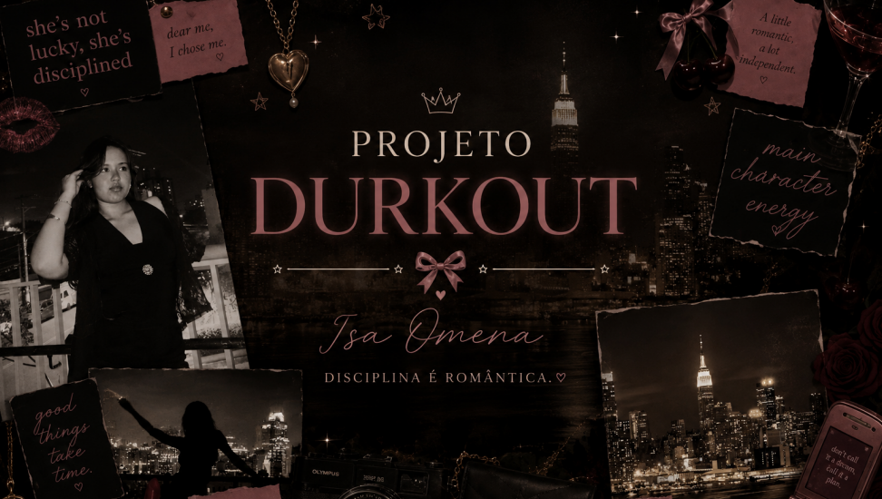
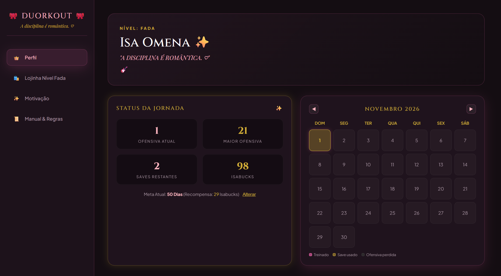
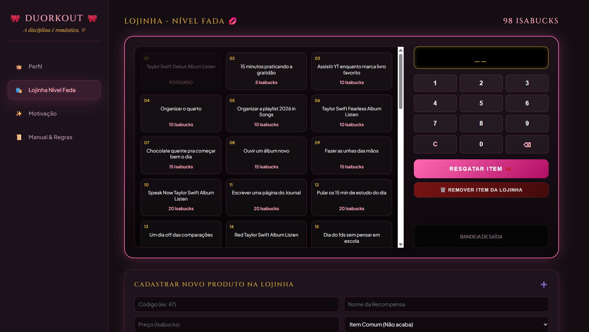
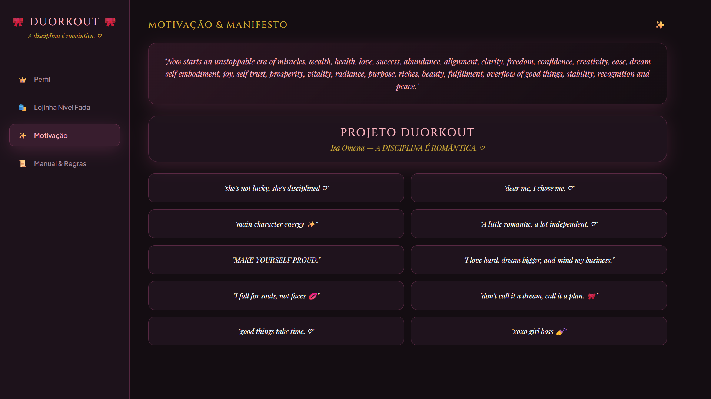
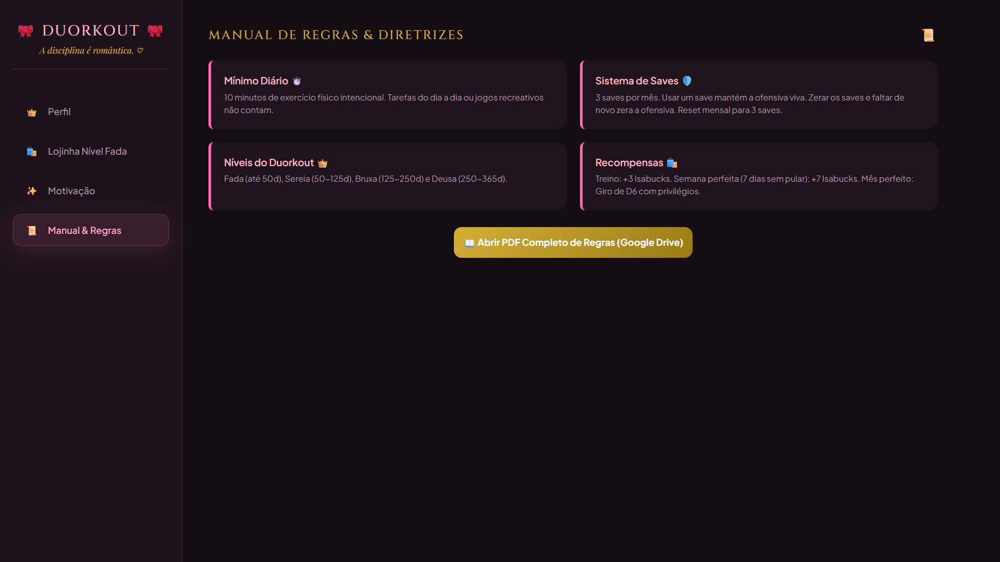

<div align="center">



<br><br>

# 🎀 DUORKOUT 🎀

### *a disciplina é romântica.* ♡

<br>


<br>

> *"A ofensiva existe para incentivar consistência, não para gerar culpa."*

</div>

---

## 💌 Sobre

**Duorkout** é o meu app pessoal pra transformar exercício físico em jogo.

Funciona assim: eu me exercito pelo menos **10 minutos por dia** → mantenho minha **ofensiva** (sim, igual à do Duolingo) → ganho **Isabucks** → gasto numa **lojinha** de mimos sem culpa, tipo noite de filme com pipoca, hora do karaokê ou ouvir um álbum da Taylor Swift.

**O problema que ele resolve:** motivação vai e vem. Disciplina precisa de um sistema. Eu queria algo que me desse vontade de voltar todo dia, que me deixasse descansar quando preciso (olá, *saves*) e que nunca me fizesse sentir mal por tropeçar.

**Por que eu fiz:** porque eu achava que nunca ia conseguir manter uma rotina. E se for pra ter uma rotina, que ela seja bonita, rosa e com cara de *main character*. 🩷

---

## 🗝️ Índice

- [Demonstração](#-demonstração)
- [O jogo (regras)](#-o-jogo)
- [Tecnologias](#-tecnologias)
- [Instalação](#-instalação)
- [Como usar](#-como-usar)
- [Configuração](#-configuração)
- [Contribuindo](#-contribuindo)
- [Licença](#-licença)
- [Autora](#-autora)

---

## 📸 Demonstração

<div align="center">

| 👑 Perfil | 🛍️ Lojinha |
| :---: | :---: |
|  |  |

| ✨ Motivação | 📜 Manual & Regras |
| :---: | :---: |
|  |  |

</div>

---

## 🎲 O jogo

### A regra de ouro

O mínimo diário são **10 minutos de exercício físico intencional**. Ou seja: andar muito no mercado não conta, e Just Dance com as amigas "só pra se divertir" também não. 😌

### Saves

Todo mês você começa com **3 saves**. Cada dia pulado gasta um. Se acabarem, a ofensiva reseta. Eles voltam a 3 no mês seguinte.

### Níveis

A lojinha passa por uma **reforma** a cada nível, sempre com produtos melhores e mais sofisticados.

| Nível | Dias de ofensiva |
| :--- | :--- |
| 🧚 Fada | até 50 |
| 🧜‍♀️ Sereia | 50 – 125 |
| 🧙‍♀️ Bruxa | 125 – 250 |
| 🔱 Deusa | 250 – 365 |

### Como ganhar Isabucks 💸

| Conquista | Recompensa |
| :--- | :--- |
| Lição terminada | 3 isabucks |
| Semana perfeita (7 dias sem pular) | 7 isabucks |
| Bater a meta de ofensiva | a diferença entre a meta e a ofensiva inicial |
| Bater a maior ofensiva | 22 isabucks |
| Mês perfeito | rola um **D6** 🎲 |

<details>
<summary><b>🎲 O que o D6 do mês perfeito sorteia?</b></summary>

<br>

| Dado | Prêmio |
| :---: | :--- |
| 1 | 🪙 **Baú do tesouro:** +30 isabucks |
| 2 | 🎟️ **Cupom de desconto:** próxima compra pela metade do preço |
| 3 | 🛡️ **Save extra:** começa o próximo mês com 4 saves |
| 4 | 🤪 **O chefe enlouqueceu:** um item da lojinha de até 30 isabucks de graça |
| 5 | ✖️2 **Meta duplicada:** a recompensa da meta passa a valer o dobro |
| 6 | 🎁 **Oferta de saves:** mês que vem começa com os saves atuais + 3 (limite de 7) |

</details>

<details>
<summary><b>🏅 Milestones de ofensiva</b></summary>

<br>

| Dias | Recompensa |
| :---: | :--- |
| 3 | 3 isabucks |
| 7 | 7 isabucks |
| 13 | 13 isabucks |
| 30 | 25 isabucks |
| 60 | 40 isabucks |
| 77 | 50 isabucks |
| 100 | 75 isabucks 🥳 |
| 200 | 100 isabucks 🐥 |
| 300 | 125 isabucks 👯 |
| 365 | 200 isabucks!!! 💃 |

</details>

### A lojinha 🛍️

Mimos de **5 a 111 isabucks**: chocolate quente, unhas feitas, noite de filmes, dormir depois das 23h sem culpa, passe pra casa da Isabelle e por aí vai.

Os **colecionáveis** são os álbuns da Taylor Swift, de *Debut* a *The Life of a Showgirl*. O emoji de cada era fica na frente do seu nome no perfil, e só dá pra comprar **uma vez**. São 11 pra colecionar. 🏆

> **OBS:** você não é proibida de fazer essas coisas se não tiver isabucks. É um mimo por *ter* o suficiente: um privilégio merecido. É sobre fazer **sem culpa**, porque você se esforçou por aquilo.

### Um lembrete importante 🌸

Quando bater uma meta, **não pule direto pra próxima**. Pare um momento, olhe pra trás e pense: *"Há alguns meses eu achava que nunca conseguiria manter uma rotina."*

Essa é a magia do Duorkout.

---

## 🛠️ Tecnologias

Zero frescura. É um projeto de **um único arquivo**:

- **HTML5**: estrutura
- **CSS3**: visual dark, rosa e dourado, com *glassmorphism*
- **JavaScript** (puro, sem framework): toda a lógica do jogo
- **`localStorage`**: salva o progresso direto no navegador
- **Google Fonts**: Cinzel, Playfair Display e Plus Jakarta Sans

Sem Node, sem build, sem banco de dados, sem servidor.

---

## 🚀 Instalação

**Pré-requisito:** um navegador. É sério, só isso. 🩷

```bash
# 1. Clone o repositório
git clone https://github.com/SEU-USUARIO/duorkout.git

# 2. Entre na pasta
cd duorkout

# 3. Abra o arquivo no navegador
open ProjetoDuorkout.html        # macOS
xdg-open ProjetoDuorkout.html    # Linux
start ProjetoDuorkout.html       # Windows
```

Ou dê dois cliques no `ProjetoDuorkout.html`. Pronto.

> 💡 Quer usar no celular? Hospede no [GitHub Pages](https://pages.github.com/) (Settings → Pages → branch `main`) e adicione o link à tela inicial.

---

## 💖 Como usar

O app tem **quatro abas** no menu lateral:

| Aba | O que tem lá |
| :--- | :--- |
| 👑 **Perfil** | Ofensiva atual, maior ofensiva, saves, isabucks, meta, calendário do mês, milestones, colecionáveis e histórico de compras |
| 🛍️ **Lojinha** | O catálogo do seu nível, onde você escolhe o que comprar e pode adicionar ou remover itens |
| ✨ **Motivação** | Vision board e o mantra: *Motivação ~~Motivação~~ **Disciplina.*** |
| 📜 **Manual & Regras** | Tudo que está na seção [O jogo](#-o-jogo), sempre à mão |

**O ritual diário:**

1. Abra o app. Ele pergunta sobre os dias pendentes: *você treinou?*
2. Respondeu **sim** → ofensiva +1 e isabucks na conta ✨
3. Respondeu **não** → um save é gasto 🛡️
4. Tem isabucks? Vá na **Lojinha**, digite o código do item e compre.
5. Fechou um mês perfeito? **Role o D6.** 🎲

**Dica:** o calendário mostra cada dia com uma cor: 🩷 treinado, 💛 save usado, 🖤 ofensiva perdida.

---

## ⚙️ Configuração

Aqui **não tem `.env`**. Nenhuma chave, nenhum segredo. 🎉

Mas dá pra personalizar duas coisas:

**1. O catálogo da lojinha:** edite a constante `INITIAL_CATALOG` dentro do `<script>`:

```js
{ code: "02", name: "15 minutos praticando a gratidão", price: 5, collectible: false },
```

(Ou use os botões de adicionar/remover item direto na aba da lojinha.)

**2. Seus dados:** ficam no `localStorage` do navegador, na chave:

```js
const STORAGE_KEY = "Duorkout_PlayerData_v5";
```

⚠️ Limpar os dados do navegador **apaga seu progresso**. Mudar o nome dessa chave também *começa tudo do zero*, então trate com carinho.

---

## 🤝 Contribuindo

Esse é um projeto pessoal, mas se você quiser deixar sua marca (ou montar seu próprio Duorkout), fique à vontade:

1. Dê um **fork** 🍴
2. Crie uma branch: `git checkout -b feat/minha-ideia`
3. Faça suas alterações e dê **commit** com mensagens no estilo:
   - `feat: adiciona nível Sereia na lojinha`
   - `fix: corrige contagem de saves no virar do mês`
   - `style: ajusta cores do calendário`
   - `docs: atualiza o README`
4. Dê **push** e abra um **Pull Request** contando o que mudou 💌

Achou um bug ou teve uma ideia? Abra uma **Issue**. Ideias de itens novos pra lojinha são muito bem-vindas. 🛍️

---

## 📜 Licença

Distribuído sob a licença **MIT**. Você pode usar, copiar e modificar à vontade, só mantenha o crédito. Veja o arquivo [`LICENSE`](LICENSE) para mais detalhes.

> As referências a álbuns, nomes e marcas (Taylor Swift, The Office etc.) pertencem aos seus respectivos donos. Aqui é só fã-projeto feito com carinho.

---

## 👑 Autora

<div align="center">

**Isa Omena** ✨

*"she's not lucky, she's disciplined."*

[](https://github.com/isabellaomena)
[](https://www.instagram.com/isabella_omena/)

<br>

*Now starts an unstoppable era of miracles, wealth, health, love, success, abundance, alignment, clarity, freedom, confidence...* 🎀

**~~Motivação~~ Disciplina.**

</div>